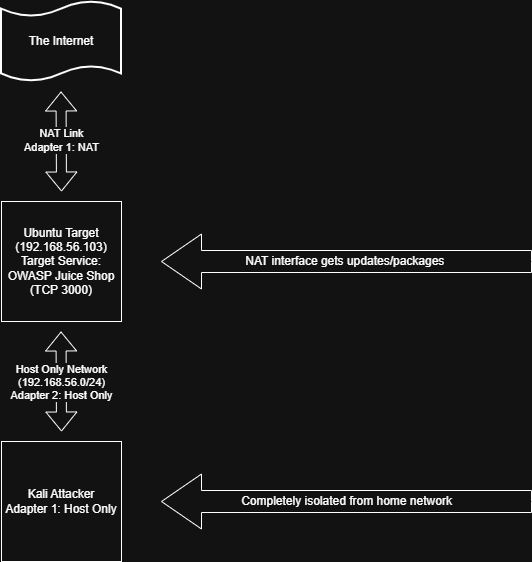

# PurpleElfLab

Welcome to my Cybersecurity Sandbox Project!

This repository documents my hands-on home lab environment exploring offensive security techniques, defensive telemetry, and security control validation. As I transition toward governance, risk, and compliance (GRC), this project bridges the gap between technical execution and framework mapping (OWASP, NIST)—documenting *how things break* and *how to prove controls work*.

* **[Comprehensive Lab Journal (Google Doc)](https://docs.google.com/document/d/1rYEkTRwo3_lAwYd9qyysgvw8OEdIT0whuvrBdyEucD4/edit?usp=sharing)**: Detailed step-by-step documentation, threat analyses, and journal entries.
* **Repository Artifacts**: Automated exploit scripts (`bypass.py`) and raw terminal execution logs (`.log`) serving as verifiable audit evidence.

---

## Lab Network Architecture

